# voron-knomi

**KNOMI-NG** is alternative firmware for the [BTT KNOMI V2](https://github.com/bigtreetech/KNOMI) round display, built for Voron printers running Klipper. It replaces the stock GIF faces with drawn eyes that react to the printer, shows print progress with the model's thumbnail, and has a screen for the [Box Turtle](https://github.com/ArmoredTurtle/AFC-Klipper-Add-On) multi-filament unit.

<p align="center">
  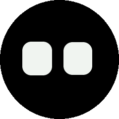
  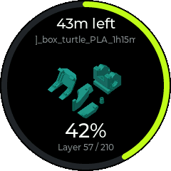
  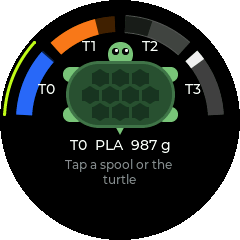
  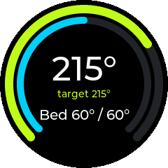
</p>

## Screens

Swipe left and right between them. After 30 seconds without a touch the KNOMI goes back to the face, or to whatever needs attention.

| | |
|---|---|
|  | **Face.** The eyes blink, look around and react: squint while probing, focus while printing, look worried when the Box Turtle needs help, angry on a Klipper shutdown, startled when you tap them. Mounted on the toolhead, they swing with its acceleration. Text from `SET_DISPLAY_TEXT` / `M117` runs along the bottom edge. |
| 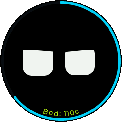 | **Print start.** Each stage your `PRINT_START` macro announces ("Bed: 110c", "Leveling"...) shows on the edge while the rim fills with the heat-up. A message like `Soak for 5 min` becomes a countdown. |
|  | **Print.** The slicer thumbnail inside a progress ring, time left, layer and file name. |
| 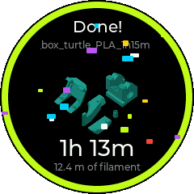 | **Done.** Confetti, print time and filament used. It stays up until someone taps it. |
|  | **Temperatures.** Nozzle and bed with their targets. |
|  | **Box Turtle.** Lanes around the top of the ring, filled in their filament colour as far as each spool is full. The turtle walks while AFC moves filament and hides when AFC reports an error. Shown only when Klipper has an AFC unit (and can be turned off). |
| 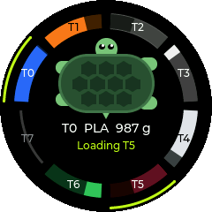 | **Two Box Turtles.** Up to 8 lanes: the second unit takes the lower half of the ring. |
| 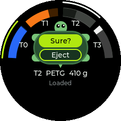 | **Box Turtle commands.** Tap a spool to load or eject it; tap the turtle for the unit's light, unload or reset. The buttons appear on the turtle's shell. Every command that moves filament needs a second tap, and all of them are locked while printing. |
| 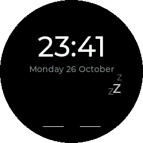 | **Night clock.** After the printer has been idle for a while, the eyes close under a dimmed clock. |

Five colour themes (Neon, Cyan, Amber, Magenta, Ice), with white or theme-coloured eyes:

<p align="center">
  
  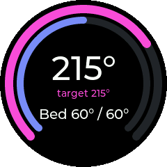
  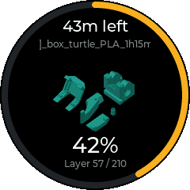
</p>

## What you need

- A **BTT KNOMI V2** (the touchscreen version, ESP32-S3). The KNOMI V1 is not supported.
- Klipper with Moonraker. The KNOMI connects to Moonraker's websocket on port 7125.
- Optional: a Box Turtle (or two, up to 8 lanes) running AFC-Klipper-Add-On 1.2 or newer.

## Install

### Over Wi-Fi, from the stock firmware

This is the tested path. It keeps the stock firmware's GIFs on the device, and you can go back to stock the same way.

1. Download `knomi-ng-ota.bin` from the [latest release](../../releases/latest).
2. Open your KNOMI's page in a browser (its IP address, or `http://knomi.local`), click **Update FW** and upload the file. Or from a terminal:
   ```sh
   curl -F "MD5=$(md5sum knomi-ng-ota.bin | cut -d' ' -f1)" \
        -F "firmware=@knomi-ng-ota.bin;filename=firmware" http://<knomi-ip>/update
   ```
3. The KNOMI restarts into KNOMI-NG. See [First start](#first-start).

### Over USB, with the web installer

Open the [install page](https://thediymaker.github.io/voron-knomi/) in Chrome or Edge, hold the KNOMI's button while plugging it into your computer, then click **Install**. The button is needed because the KNOMI's screen uses the ESP32-S3's USB pins, so the running firmware turns USB off and the installer can't switch it into flashing mode by itself. This writes the whole flash, so the stock GIFs are erased.

The USB installer is newer than the Wi-Fi path and hasn't been tested on as many units yet.

### First start

KNOMI-NG tries to take over the stock firmware's Wi-Fi and Moonraker settings. If it can't (older stock versions store them differently), it opens its own setup network:

1. The screen shows a network name (`KNOMI-xxxx`) and a password that only appears there.
2. Join that network and open `http://192.168.4.1`.
3. Set an admin password. Settings and updates need it from then on (user `admin`).
4. Under **Settings**, enter your Wi-Fi network, its password and your printer's address, then save.

Long-press the face to see the KNOMI's IP address and version at any time.

## Settings

Everything is on the KNOMI's web page (`http://knomi.local` or its IP):

- Wi-Fi, hostname, Moonraker host, port and optional API key
- Theme, eye colour, and what the eyes react to: toolhead motion (accelerometer, for toolhead mounts), nozzle position (for frame mounts) or nothing
- Box Turtle screen on or off
- Time zone and 12/24-hour clock, sleep timeout, brightness awake and asleep
- Firmware update, a live screenshot of the display, the device log, and backups of the flash partitions

Stored passwords are never sent back to the browser, and the setup network uses a fresh password that appears only on the screen.

## Klipper side

Nothing has to change in your Klipper config.

- **Moonraker access.** The KNOMI's address must be in Moonraker's `trusted_clients`, or set an API key in the KNOMI's settings.
- **Stage text.** Anything your macros send with `SET_DISPLAY_TEXT MSG="..."` or `M117` shows on the face. Print-start stages stay up while the printer gets ready; other messages show for 20 seconds when they appear and briefly every 10 minutes after that.
- **Soak countdown.** A message containing `Soak for <n> min` (or `sec`) counts down.
- **Lane colours.** The Box Turtle screen uses AFC's lane colours. Set them with `SET_COLOR LANE=lane1 COLOR=FF0000`, or through Spoolman.

### Box Turtle commands

| On the KNOMI | G-code sent |
|---|---|
| Spool → Load | `CHANGE_TOOL LANE=<lane>` |
| Spool → Eject | `LANE_UNLOAD LANE=<lane>` |
| Loaded spool → Unload, or turtle → Unload | `TOOL_UNLOAD` |
| Turtle → Reset (after an error) | `RESET_FAILURE` |
| Turtle → Light | `TURN_ON_AFC_LED` / `TURN_OFF_AFC_LED` |

## Updating

From the KNOMI's web page: **Firmware → Install**, choose `knomi-ng-ota.bin`. Or:

```sh
curl -u admin:<password> -F "firmware=@knomi-ng-ota.bin" http://knomi.local/update
```

If a new version crashes three times in a row within a minute of starting, the KNOMI switches back to the firmware in its other slot by itself.

## Going back to stock

Install BTT's `knomi2_firmware.bin` (from [bigtreetech/KNOMI](https://github.com/bigtreetech/KNOMI/tree/master/KNOMI2/Firmware)) the same way you install an update. If you installed KNOMI-NG over Wi-Fi, the stock GIFs are still there.

## Building

```sh
pip install platformio
pio run -e knomiv2                    # firmware: .pio/build/knomiv2/firmware.bin
scripts/merge_factory.sh dist/knomi-ng-factory.bin   # full image for USB installs
make -C sim run                       # render every screen to sim/out/*.png
```

The UI in `ui/` is plain C++ on LVGL 9, so the desktop simulator in `sim/` renders the same screens as the device. `sim/sim.cpp` scripts the printer states; `sim/mockups.cpp` holds design concepts.

## Roadmap

- **IDEX.** Screens for independent dual carriages: both toolheads on the X rail, the parked one dimmed with its standby temperature, and copy/mirror modes.
- Quick actions during a print (pause, light, filament swap, cancel).
- The job's filament palette on the print screen.
- Spoolman spool names and weights.

<p align="center">
  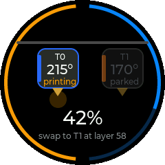
  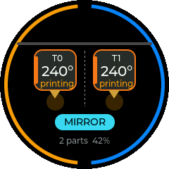
</p>

## Credits

Pin assignments come from BIGTREETECH's [KNOMI](https://github.com/bigtreetech/KNOMI) firmware. Built with [LVGL](https://lvgl.io), [LovyanGFX](https://github.com/lovyan03/LovyanGFX), [ArduinoJson](https://arduinojson.org) and [arduinoWebSockets](https://github.com/Links2004/arduinoWebSockets). [DiverOfDark/KNOMI](https://github.com/DiverOfDark/KNOMI) showed what alternative KNOMI firmware can look like.

## License

MIT. See [LICENSE](LICENSE).
